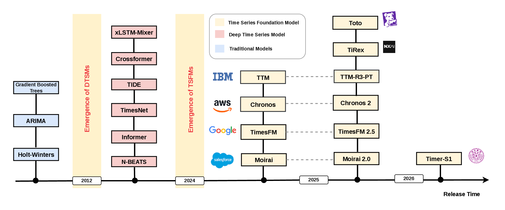
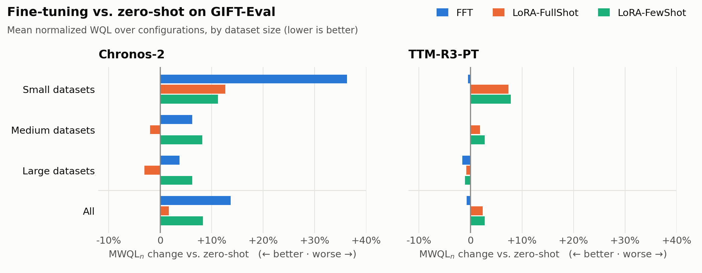
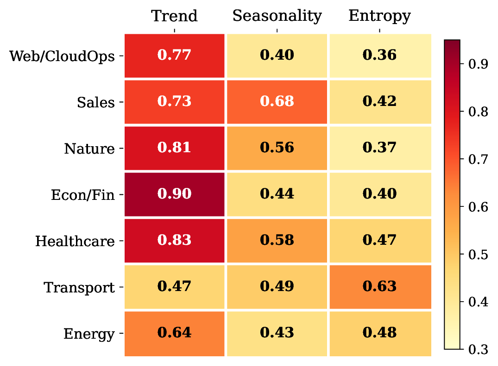
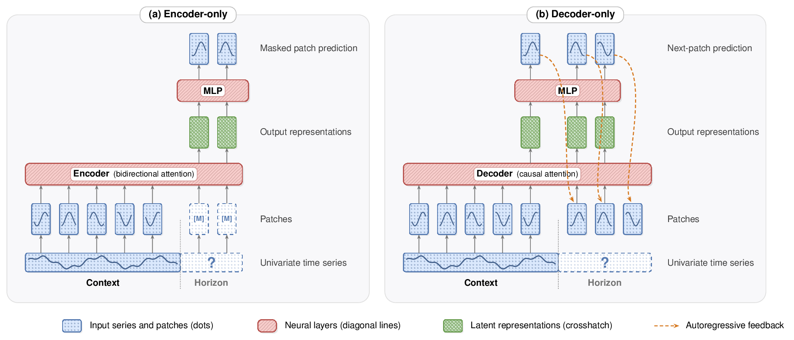

<div align="center">

# Fine-Tuning Time Series Foundation Models on GIFT-Eval

**Code for the empirical study of** *Foundation Models for Time Series Forecasting: A Review and an Empirical Study of Fine-Tuning Strategies*

Morad Laglil<sup>1,2</sup> · Bertrand Pracca<sup>2</sup> · Emilie Devijver<sup>1</sup> · Eric Gaussier<sup>1</sup>

<sup>1</sup>Univ. Grenoble Alpes, CNRS, Grenoble INP, LIG &nbsp;&nbsp; <sup>2</sup>Savoye

[](#citation)
[](https://huggingface.co/datasets/Salesforce/GiftEval)
[](#models-and-strategies)
[](#setup)
[](LICENSE)

</div>

<p align="center">
  
</p>

Time series foundation models are usually applied **zero-shot**: a model pre-trained on a large corpus forecasts
a new dataset without any parameter update. But when target data is available, *is it worth fine-tuning them?*
The paper reviews the architectures, pre-training strategies and adaptation methods of these models, then
answers this question empirically. Two top-ranked, openly fine-tunable models of the GIFT-Eval leaderboard,
**Chronos-2** and **TTM-R3-PT**, are compared in zero-shot mode and under three fine-tuning strategies on
**every configuration of the GIFT-Eval benchmark** (dataset × frequency × horizon).

This repository contains everything needed to rerun that study: the fine-tuning pipelines for both models,
the exact configurations, and the scripts that turn raw results into the tables of the paper.

## Key findings

- **Zero-shot is a strong default.** Fine-tuning improves on zero-shot in many settings, especially at long horizons,
  but the gains are usually small (mostly below 3%, at most 5–7%).
- **The strategy must match the model.** LoRA on the full training split is the most reliable option for Chronos-2,
  whereas full fine-tuning degrades it in most settings (up to +36% error on small datasets). For the compact
  TTM-R3-PT, full fine-tuning is the best or near-best strategy, while LoRA brings little.
- **The amount and structure of target data matter.** On small datasets, and in particular short or few series,
  both models are best used zero-shot. The benefit of LoRA for Chronos-2 comes with datasets made of *many* series
  rather than *long* series.
- **Data- and parameter-efficient fine-tuning (LoRA-FewShot)** is competitive in some settings, but is clearly worse
  than LoRA-FullShot for Chronos-2.

All results use one default set of hyperparameters per model, without per-dataset tuning, i.e. a realistic
tuning-free deployment rather than the best achievable performance.

## Results at a glance

<p align="center">
  <picture>
    <source media="(prefers-color-scheme: dark)" srcset="assets/finetuning_vs_zeroshot_dark.png">
    
  </picture>
</p>

Average normalized errors over all configurations (lower is better; 1 = Seasonal Naive; mean ± std over seeds):

| Model | Metric | Zero-Shot | FFT | LoRA-FullShot | LoRA-FewShot |
|---|---|---|---|---|---|
| Chronos-2 (94 configs) | MWQL<sub>n</sub> | **0.356** | 0.404 ± 0.000 | 0.362 ± 0.003 | 0.385 ± 0.003 |
| | MAPE<sub>n</sub> | **0.792** | 0.986 ± 0.001 | 0.843 ± 0.014 | 0.809 ± 0.009 |
| TTM-R3-PT (97 configs) | MWQL<sub>n</sub> | 0.399 | **0.396 ± 0.001** | 0.409 ± 0.000 | 0.410 ± 0.001 |
| | MAPE<sub>n</sub> | 0.920 | **0.914 ± 0.001** | 0.932 ± 0.007 | 0.940 ± 0.005 |

Breakdowns by dataset size, number of series, mean series length and domain × horizon are produced by
[`analysis/aggregate.py`](#from-raw-results-to-the-paper-tables).

## Repository structure

```
.
├── chronos2/
│   ├── run_chronos2.py        # zero-shot + 3 fine-tuning strategies for Chronos-2 (AutoGluon)
│   ├── run_seed42.sh          # all four strategies, seed 42
│   └── requirements.txt
├── ttm/
│   ├── run_ttm_r3.py          # TTM-R3 GIFT-Eval runner (granite-tsfm) with our LoRA extension
│   ├── src/                   # TTM GluonTS predictor and utilities (vendored)
│   ├── resources/             # dataset properties used by the runner
│   ├── scripts/               # zero_shot.sh, fft_fullshot.sh, lora_fullshot.sh, lora_fewshot.sh, run_seed42.sh
│   └── requirements.txt
├── analysis/
│   ├── aggregate.py           # normalization by Seasonal Naive + all tables of the paper
│   ├── make_figure.py         # figure above
│   ├── seasonal_naive.csv     # official GIFT-Eval Seasonal Naive results (normalization reference)
│   └── dataset_properties.csv # size, number of series, mean length of each GIFT-Eval dataset
├── results/paper/             # raw results behind the paper tables (all seeds)
├── scripts/
│   ├── setup_envs.sh          # creates the two conda environments
│   ├── download_gifteval.sh   # downloads GIFT-Eval and writes its path to .env
│   └── smoke_test.sh          # 4 strategies x 1 small configuration, to check an installation
└── assets/                    # figures
```

## Setup

The experiments need a CUDA GPU (the analysis scripts run on CPU). The two models rely on incompatible
`torch`/`transformers` versions, so each gets its own environment:

```bash
git clone https://github.com/MoradLaglil/tsfm-finetuning-gifteval.git
cd tsfm-finetuning-gifteval
bash scripts/setup_envs.sh          # creates conda envs "tsfm-chronos2" and "tsfm-ttm" (Python 3.11)
```

<details>
<summary>What the script installs (manual installation)</summary>

```bash
# Chronos-2: AutoGluon 1.5.0, chronos-forecasting 2.2.2, torch 2.9.1, transformers 4.57.6
conda create -n tsfm-chronos2 python=3.11 -y && conda activate tsfm-chronos2
pip install -r chronos2/requirements.txt
pip install --no-deps "salesforce-gift-eval @ git+https://github.com/SalesforceAIResearch/gift-eval.git@795b246e307941b05316a8f00103002a869b7af0"

# TTM-R3-PT: torch 2.4.0, transformers 4.50.3, tsfm_public from the public TTM-R3 release branch
conda create -n tsfm-ttm python=3.11 -y && conda activate tsfm-ttm
pip install -r ttm/requirements.txt
pip install --no-deps "salesforce-gift-eval @ git+https://github.com/SalesforceAIResearch/gift-eval.git@795b246e307941b05316a8f00103002a869b7af0"
pip install --no-deps "granite-tsfm @ git+https://github.com/ibm-granite/granite-tsfm.git@e911cd16a0901d6a51159f636a50ee9db895ae78"
```

`gift-eval` and `granite-tsfm` are installed with `--no-deps` because their own version pins conflict with the
versions used for the paper; everything they need at runtime is already in the requirements files.
</details>

Model weights are downloaded automatically from the Hugging Face Hub on first use
([`autogluon/chronos-2`](https://huggingface.co/autogluon/chronos-2), [`ibm-research/ttm-r3`](https://huggingface.co/ibm-research/ttm-r3)).

## Data: GIFT-Eval



[GIFT-Eval](https://github.com/SalesforceAIResearch/gift-eval) gathers 23 datasets from seven domains
(Econ/Fin, Energy, Healthcare, Nature, Sales, Transport, Web/CloudOps), sampled at frequencies from seconds to years.

**Download** (~1.5 GB, from [`Salesforce/GiftEval`](https://huggingface.co/datasets/Salesforce/GiftEval)):

```bash
conda activate tsfm-chronos2        # any of the two environments
bash scripts/download_gifteval.sh   # -> data/gift-eval/, and GIFT_EVAL=<abs path> in .env
```

Equivalently: `huggingface-cli download Salesforce/GiftEval --repo-type=dataset --local-dir data/gift-eval`,
then `cp .env.example .env` and set `GIFT_EVAL` to that folder. The runners read `.env` from the repository root.

**How GIFT-Eval builds the splits.** We use the official loader, `gift_eval.data.Dataset(name, term, to_univariate)`,
unchanged. Each dataset is a Hugging Face `datasets` folder (one record per series, with a 1-D target, or a 2-D
target for multivariate data). For a configuration:

1. **Horizon** — the prediction length *H* depends on the frequency (e.g. 48 for hourly and minute data, 30 for
   daily, 8 for weekly, 12 for monthly; M4 uses its own lengths, e.g. 6 for yearly, 13 for weekly), multiplied by
   1 (*short*), 10 (*medium*) or 15 (*long*). Medium and long horizons exist only for the 21 high-frequency
   dataset entries.
2. **Test windows** — the last *w × H* time steps of every series form *w* consecutive, non-overlapping test windows,
   with *w* = min(max(1, ⌈0.1 · shortest series length / *H*⌉), 20). Each window is forecast from all the
   history before it.
3. **Training / validation** — `validation_dataset` contains everything before the test windows;
   `training_dataset` stops *H* steps earlier, leaving one validation window.

How each pipeline uses these splits:

| | Chronos-2 | TTM-R3-PT |
|---|---|---|
| Multivariate data | split into univariate series (`to_univariate=True`) | kept multivariate (channels) |
| Fine-tuning data | `validation_dataset` (all data before the test windows); AutoGluon keeps the last *H* steps aside for its validation score | sliding windows of `training_dataset` |
| Validation | not used for checkpoint selection | last window of each series of `validation_dataset` (early stopping) |

**Configurations.** Chronos-2 is run on 52 dataset/frequency entries, i.e. **94 configurations**; TTM-R3-PT on the
same entries plus `m4_yearly`, `m4_quarterly` and `restaurant`, i.e. **97 configurations**, as reported in the
paper. The lists are at the top of `chronos2/run_chronos2.py` and `ttm/run_ttm_r3.py`.

## Models and strategies

<p align="center">
  
</p>

| Strategy | Parameters updated | Training data |
|---|---|---|
| **Zero-Shot** | none | none |
| **FFT** (full fine-tuning) | all | whole training split |
| **LoRA-FullShot** | low-rank adapters | whole training split |
| **LoRA-FewShot** | low-rank adapters | 20% of the training data |

Settings used by this code (identical for all datasets, no per-dataset tuning):

| | Chronos-2 (AutoGluon 1.5.0) | TTM-R3-PT (granite-tsfm runner + our LoRA extension) |
|---|---|---|
| Training budget | **2,000** gradient steps (`--steps`), final weights kept | at most 4,000 steps; validation every 30 steps, early stopping after 5 evaluations without improvement, best checkpoint kept |
| Learning rate | 1e-5 (FFT and LoRA) | 1e-4 (FFT), 1e-3 (LoRA) |
| Batch size | 32 (64 for LoRA-FewShot) | chosen automatically from the dataset size |
| LoRA | r = 8, α = 16 (AutoGluon default) | r = 8, α = 16, dropout 0; adapters on the mixer MLP/gating layers and the head projection; multi-quantile head fully trained |
| Few-shot data | last 20% of the time steps of each series (at least 2*H*+1 steps) | 20% of the training windows sampled at random, capped at 100,000 |
| Very small datasets | — | official default for all strategies: if the training fraction gives fewer than 200 windows, 90% of the windows are used (50 epochs); with 10 windows or fewer, the zero-shot forecast is kept |
| Loss | quantile loss | quantile loss |

## Reproducing the experiments

Each command runs one strategy for seed 42 over all configurations and appends one row per configuration to a CSV.
Finished configurations are skipped, so an interrupted run can be restarted with the same command. Full sweeps take
many GPU hours: run each strategy as a separate job.

### Chronos-2

```bash
conda activate tsfm-chronos2
python chronos2/run_chronos2.py --strategy zero-shot     --seed 42
python chronos2/run_chronos2.py --strategy fft           --seed 42
python chronos2/run_chronos2.py --strategy lora-fullshot --seed 42
python chronos2/run_chronos2.py --strategy lora-fewshot  --seed 42
# or all four:  bash chronos2/run_seed42.sh
```

Results: `results/chronos2/<strategy>/seed42/leaderboard.csv` (AutoGluon reports `WQL` and `MAPE` with a minus sign,
higher is better; the analysis takes absolute values). Options: `--steps` (default 2000), `--datasets`, `--terms`,
`--output-dir`.

### TTM-R3-PT

```bash
conda activate tsfm-ttm
bash ttm/scripts/zero_shot.sh
bash ttm/scripts/fft_fullshot.sh
bash ttm/scripts/lora_fullshot.sh
bash ttm/scripts/lora_fewshot.sh
# or all four:  bash ttm/scripts/run_seed42.sh
```

Results: `results/ttm/<version>/all_results.csv` (e.g. `results/ttm/TTM-R3-LORA-FullShot-Seed42/`). The scripts
accept any extra option of `run_ttm_r3.py`, e.g. `--datasets`, `--terms`, `--results_dir`, `-seed`.

### Smoke test

Before launching full sweeps, check your installation by running the four strategies of each model on a single
small configuration (`ett1/D`, short horizon; Chronos-2 with 200 instead of 2,000 steps). Each run must write one
result row. On an RTX A6000 this takes about 3 minutes for Chronos-2 and 7 minutes for TTM-R3-PT:

```bash
conda activate tsfm-chronos2 && bash scripts/smoke_test.sh chronos2
conda activate tsfm-ttm      && bash scripts/smoke_test.sh ttm
```

Results go to `results/smoke/`. Use `DATASET=<name>` or `STEPS=<n>` to change the configuration or the
Chronos-2 budget. The same `--datasets` / `--terms` options work for the full runners.

## From raw results to the paper tables

Every configuration is normalized by the official GIFT-Eval Seasonal Naive results,
MWQL<sub>n</sub> = WQL / WQL<sub>naive</sub> and MAPE<sub>n</sub> = MAPE / MAPE<sub>naive</sub>,
then averaged within groups and reported as mean ± std over seeds. Datasets are grouped with the 0.33/0.66 quantiles
used in the paper: size ≤ 62,982 / ≤ 511,978 / larger observations; number of series ≤ 21 / ≤ 323 / more;
mean series length ≤ 720 / ≤ 8,640 / longer.

```bash
python analysis/aggregate.py --check        # paper results (results/paper/), checked against the published values
python analysis/aggregate.py --source runs  # your own runs (results/chronos2/, results/ttm/)
python analysis/make_figure.py              # figure of this README
```

Tables are printed as Markdown and saved as CSV in `analysis/output/`. `results/paper/` holds the raw files
used for the paper: Chronos-2 fine-tuning with seeds 42 and 1000, TTM-R3-PT with seeds 42, 58 and 100
(zero-shot is deterministic and run once).

**Reproducibility note.** Fine-tuning on GPU is not bit-for-bit deterministic (cuDNN autotuning, data loading,
hardware), so reruns can differ slightly from the published numbers, as the seed-to-seed standard deviations above
illustrate. Zero-shot results should match exactly.

## Citation

```bibtex
@article{laglil2026foundation,
  title   = {Foundation Models for Time Series Forecasting: A Review and an Empirical Study of Fine-Tuning Strategies},
  author  = {Laglil, Morad and Pracca, Bertrand and Devijver, Emilie and Gaussier, Eric},
  journal = {Data \& Knowledge Engineering},
  year    = {2026}
}
```

## Acknowledgements

This work builds on [GIFT-Eval](https://github.com/SalesforceAIResearch/gift-eval) (Salesforce),
[Chronos-2](https://github.com/amazon-science/chronos-forecasting) and [AutoGluon](https://github.com/autogluon/autogluon)
(Amazon), and [TTM / granite-tsfm](https://github.com/ibm-granite/granite-tsfm) (IBM). The TTM runner in `ttm/` is
adapted from the official TTM-R3 GIFT-Eval code (branch `ttm-r3-release-mq2`), to which we added LoRA fine-tuning
and step-based training with validation every 30 steps; see [NOTICE](NOTICE) for the full list of changes. We thank Dr. Marwane Bouznif (Savoye) for
insightful discussions.

## License

Apache License 2.0 — see [LICENSE](LICENSE) and [NOTICE](NOTICE) for third-party components.
